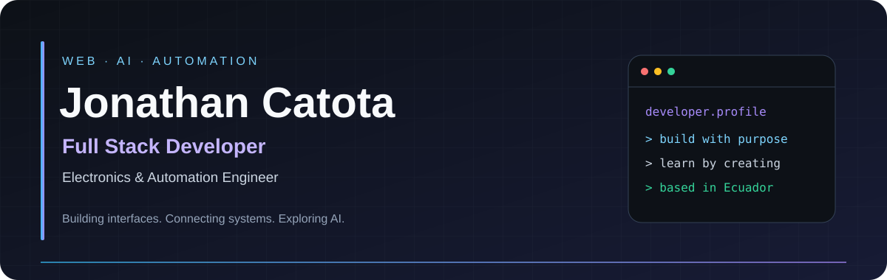



### 👋 Building useful software with web, AI & automation.

🌎 **Ecuador** · 💻 **Full Stack Development** · 🧠 **Artificial Intelligence**

---

## ⚡ A little about me

I'm **Jonathan**, a full stack developer and electronics & automation engineer. I connect web interfaces, APIs, and engineering to turn practical ideas into working software.

- 💻 **Web development:** interfaces with React and Svelte, REST API integrations, and containerized applications with Docker.
- 🤖 **AI interfaces:** experience developing user interfaces for AI chatbots in telecommunications.
- 🦾 **Engineering:** robotics and simulation projects with C++, ROS 2, and Gazebo.
- 🎓 **Learning:** AI master's coursework at VIU, including reinforcement learning.
- 🤝 **How I work:** readable code, continuous learning, and collaboration.

## 🧠 AI & interests

I'm interested in making AI useful through applications people can interact with.

| 💬 Conversational interfaces | 🎯 Learning & decision-making | 🦾 Intelligent systems |
| --- | --- | --- |
| Connecting AI models to web interfaces and chatbot experiences. | Exploring reinforcement learning through practical coursework and experiments. | Bringing together software, automation, and robot simulation. |

🔬 **Explore my work:** [Reinforcement Learning — VIU](https://github.com/Jonathan7796/Proyecto_practico_APR)

## 🛠️ Technical toolkit

| Area | Technologies |
| --- | --- |
| 🎨 Frontend | JavaScript, TypeScript, React, Svelte, HTML, CSS, Tailwind CSS |
| ⚙️ Backend & APIs | Node.js, Python, FastAPI, Flask, REST APIs |
| 🗃️ Databases | PostgreSQL, MySQL, MongoDB |
| 🧪 Testing & quality | Jest, Nock, ESLint, GitHub Actions |
| 🐳 Development & deployment | Git, Docker, Docker Compose, Linux |
| 🔬 Engineering & AI | C++, ROS 2, Gazebo, Jupyter Notebook |

## 🚀 Featured projects

### 🌐 [Page Loader](https://github.com/Jonathan7796/fullstack-javascript-project-138)

A command-line utility for downloading web pages. Combines HTTP requests and HTML processing with automated tests and continuous integration.

`Node.js` `JavaScript` `Axios` `Cheerio` `Jest` `Nock`

### 🔎 [Difference Generator](https://github.com/Jonathan7796/fullstack-javascript-project-103)

A command-line tool for comparing configuration files, with YAML parsing, a Jest test suite, and ESLint checks.

`Node.js` `JavaScript` `Commander` `js-yaml` `Lodash` `Jest`

### 🎮 [Brain Games](https://github.com/Jonathan7796/fullstack-javascript-project-98)

Interactive terminal games covering arithmetic, prime numbers, progressions, and greatest common divisors.

`Node.js` `JavaScript` `readline-sync` `ESLint`

### 🦿 [Parallel Robot Simulation](https://github.com/Jonathan7796/PFD_TIC_Parallel_robot_Catota_Jonathan)

A virtual 3UPS-1RPU parallel robot for knee rehabilitation. Connects my automation background with software development and simulation.

`C++` `ROS 2` `Gazebo` `Robotics`

---

### 🤝 Let's build something useful

Interested in **full stack development, AI interfaces, or automation**? Let's connect.

[💼 LinkedIn](https://www.linkedin.com/in/jonathan-catota) · [✉️ Email](mailto:jonathan_catota77@hotmail.com)

